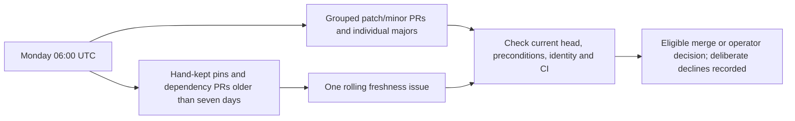

# Weekly dependency updates

This repository follows the shared dependency-update template and [issue #3](https://github.com/agenticcodingops/multi-ai-deep-research-pipeline/issues/3).
Both schedules request Monday **06:00 UTC** on the default branch, `master`;
scheduled runs can be delayed. The freshness caller also supports manual dispatch
after merge. Its workflow and script checkout use the same reviewed public
auto-code-scanning v3.1.0 commit.

## Inventory and coverage

Inventory checked against tracked files on 2026-11-09. Dependabot does not recurse.
The only supported manifest surface is GitHub Actions at `/`. There are no npm,
pip, other language package, Docker, Terraform, or hook-manager manifests anywhere
in this checkout, including the plugin sub-project. The plugin and marketplace
JSON files describe this product; they are not package-manager dependency manifests.

| Surface | Selection and location | Coverage |
|---|---|---|
| Active Actions | Checkout v5.1.0 in CI and review, v7.0.1 in the assistant workflow, floating v4 in commit hygiene; setup-python v6.3.0 in CI | Dependabot `github-actions` at `/`; existing distinct roles are preserved. |
| Review action | `anthropics/claude-code-action` v1.0.266, SHA `d535f5172dec02b204866b393d6b20b9b2aaf98d`, in both review/assistant workflows | Unconditionally ignored by Dependabot. Freshness resolves both SHAs and version comments against stable tags and compares mirrors. |
| Freshness implementation | New caller `uses`, `scanning-repo-ref`, version comment and manifest schema URL at `25f0b8722593e588ef573858bc46e1df9d7a1804` (v3.1.0) | Dependabot sees `uses`; freshness compares all four references. Update the shared template and all references together; correct a PR changing only `uses`. |
| Python test lanes | CI matrix 3.12 and 3.13 | Two separate freshness `minimum` entries. These partial runtime selections are compatibility decisions owned by the operator, not outdated exact installs or mirrors of each other. |
| Gateway guidance | LiteLLM clean-release floor v1.83.0+ in `docs/methodology/00-master-methodology.md` and its bundled orchestrator reference | Freshness `minimum` against PyPI plus mirror comparison; this is advice, not an installed gateway. |
| Hosted runners | `ubuntu-latest` in all four existing workflows and the CI matrix; `windows-latest` in that matrix | Two freshness manual reminders, with equality checks for Linux occurrences. The reusable caller's internal runner/runtime pins belong to its reviewed implementation. |
| Tool installs | Unversioned validation CLI npm install in CI; optional `@gotalab/cc-sdd` install in both spec-development overlay copies | Freshness manual reminders and documentation mirror comparison. Neither tool resolves these installs against npm or verifies their transitive dependencies. |
| Review plugin | Unversioned marketplace URL and `code-review` plugin in the review workflow | Freshness manual reminder. Neither tool authenticates upstream plugin content or measures guard compatibility. |
| Historical/local identifiers | Measured CLI versions in guard comments; malicious LiteLLM 1.82.7/1.82.8 warning; own plugin release/changelog versions; license/schema/contract identifiers; Python 3.9+ explanatory stdlib comment; fixture data | Neither: historical evidence, product releases or format/implementation context, not independent current upgrade targets. |
| Service guidance | Model names, subscription prices and unversioned app/connector advice in setup and methodology docs | Neither provides current service-catalog or pricing verification. Verify with the relevant publisher when using that guidance. |

The manifest has ten entries. Manual policy extracts selections and detects mirror
drift but does not query upstream; its source is context only. No new files here
are part of the distributable plugin; existing workflows and application files
are unchanged. The inventory is a dated snapshot, not another executable version mirror.

## Preconditions and ownership

The review workflow states (copied verbatim, with comment wrapping removed):

> Re-measure before bumping this pin, and before loosening the guard step above: the plugin's `gh pr comment` grant is honoured on every CLI version measured, so the boundary rests on that guard.

The unconditional review-action ignore preserves that boundary for both uses.
The methodology's existing gateway advice is:

> Pin LiteLLM to the official Docker image / a clean release (v1.83.0+)

Retain that safety floor and verify a clean upstream release before changing the
guidance. Historical measurements and the malicious-version warning stay intact.

Dependabot groups patch and minor updates per ecosystem/directory, leaves majors
as individual PRs, uses `chore(deps)` commits and requests the `dependencies` label.
That label was **absent** at adoption; this change creates no labels or settings.
The operator must provide it. The freshness stale-PR report also recognizes
dependency-bot authors, so that report does not rely solely on the label.

Eligible Actions/scanner patch/minor merges under the org-wide plan require a clean,
substantive review naming the current head, green checks and at least 15 minutes
since the push. Majors, runtimes, Terraform CLI/providers, production-facing
workflows, every re-measure precondition and other package changes belong to the
operator unless explicitly delegated. An operator-owned member holds its group.
An update ends when merged or deliberately declined. This adoption PR is not to
be merged by the worker.

This repository's human-only author/committer allowlist rejects dependency-bot
identities. Bot-authored PRs therefore cannot pass commit hygiene unchanged; the
operator must decide a compliant delivery path before they can land. Do not
bypass hooks, spoof an author or expand the allowlist as part of a routine bump.
The review workflow currently runs without publishing its verdict; a successful
job alone is not a substantive current-head review. No real scheduled bot PR has
yet proved end-to-end delivery. Branch-protection details could not be read with
the current credentials (HTTP 403); no settings were changed.



## Validate and maintain

From a reviewed read-only checkout of the shared dependency-update template, set
`TARGET` to this repository and run:

```sh
python -I dependency-updates/check.py "$TARGET"
```

The drift check validates the common Dependabot block and caller layout, not
manifest discovery or YAML/schema validity. Lint the new workflow with
`actionlint .github/workflows/pin-freshness.yml` and run the checks defined by
the existing CI workflow, including both script suites and plugin validation.

For a network preview, set `PLATFORM` to a separate checkout verified at the
v3.1.0 public SHA above. Use Python 3.11+ and keep the token in the environment:

```sh
GITHUB_TOKEN="$(gh auth token)" python -I -c \
  'import runpy, sys; from pathlib import Path; script = Path(sys.argv.pop(1)).resolve(); sys.path.insert(0, str(script.parent)); runpy.run_path(str(script), run_name="__main__")' \
  "$PLATFORM/scripts/pin_freshness.py" --root "$TARGET" \
  --repository agenticcodingops/multi-ai-deep-research-pipeline --dry-run
```

The dry run writes no issue. Exit 0 permits outdated pins and drift; exit 1
reports lookup/extraction failures, and exit 2 means configuration/write errors.
Inspect every section. The operator performs the first write dispatch after merge;
the schedule activates only on `master`. This adoption does not prove a scheduled
update PR, issue write or stale-PR alert from a real test case.

Keep the rolling issue open: v3.1.0 preserves its state and will not reopen it.
Put durable discussion in comments because successful runs replace the body.
When adding a package-manifest directory, add its own Dependabot entry. When
adding hand-kept pins, include every active mirror and verbatim precondition.
Use `minimum` for compatibility selections and `manual` with `review_reason` for
unsupported registries or nonnumeric identifiers. New digests require publisher
verification; extraction alone does not authenticate content. The public
[freshness guide](https://github.com/agenticcodingops/auto-code-scanning/blob/25f0b8722593e588ef573858bc46e1df9d7a1804/docs/PIN-FRESHNESS.md)
documents the schema and report semantics.
